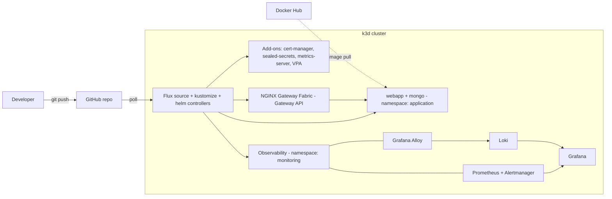

# mywebapp-k8s-helm

A GitOps-managed Kubernetes platform for a Next.js + MongoDB web app, running locally on k3d. Flux reconciles everything from this repo: infrastructure add-ons, the app's Helm chart, TLS, secrets, autoscaling and a full observability stack (metrics + logs).

> Draft notes: anything marked **[CONFIRM]** or **[FILL IN]** is a gap only you can fill. Resolve them and delete this note before publishing.

## Architecture



## Stack

| Layer | Tool | Purpose |
|---|---|---|
| Cluster | k3d (k3s in Docker) on WSL2 | Local Kubernetes |
| GitOps | Flux | Reconciles the cluster from Git |
| Packaging | Helm | App chart in `charts/mywebapp` |
| Ingress | NGINX Gateway Fabric (Gateway API) | Routes traffic to the app |
| TLS | cert-manager | Self-signed local CA issuer for the `application` namespace |
| Secrets | Sealed Secrets | Encrypted secrets safe to commit |
| Autoscaling | HPA, VPA, metrics-server | HPA scales 1-3 replicas on CPU; VPA right-sizes memory only, so the two don't fight |
| Metrics | kube-prometheus-stack | Prometheus, Alertmanager, Grafana, exporters |
| Logs | Grafana Alloy + Loki | Node log files shipped to Loki |

## Repository layout

A single Flux Kustomization (`flux-system`, path `./clusters/local-k3d`, `prune: true`) owns everything. Every folder has its own `kustomization.yaml` listing its files.

```
clusters/local-k3d/       Entry point: flux-system/ (bootstrap files) + the folders below
infrastructure/
  sources/                HelmRepositories and the gateway-api GitRepository
  crds/                   Gateway API CRDs
  controllers/            cert-manager, sealed-secrets, metrics-server, VPA, NGINX Gateway Fabric
  namespace-config/       HelmRelease for charts/infrastructure-namespace
monitoring/               kube-prometheus-stack, Loki, Grafana Alloy, namespace
apps/webapp/              HelmRelease for charts/mywebapp
charts/
  mywebapp/               App Deployment, Mongo StatefulSet, Gateway/HTTPRoute, cert, HPA, VPA, SealedSecret
  infrastructure-namespace/  LimitRange, ResourceQuota, NetworkPolicy, RBAC, cert-manager Issuers
scripts/                  bootstrap.sh, seal-secrets.sh
secrets/                  Raw secrets (git-ignored)
```

Install order is set with `dependsOn`: `infra` waits for cert-manager and sealed-secrets, `grafana-alloy` for Loki, and `mywebapp` for `infra`, NGF and the autoscalers.

## Getting started

Prerequisites: WSL2, Docker Desktop, `kubectl`, `k3d`, `flux`, `kubeseal`.

```bash
# 1. Create a short-lived fine-grained GitHub token (this repo only,
#    Administration + Contents read/write) and export it
export GITHUB_TOKEN=...

# 2. Create the k3d cluster (ports 80/443) and bootstrap Flux
scripts/bootstrap.sh

# 3. Bootstrap pushes a commit, so pull it, then revoke the token
git pull

# 4. Watch everything come up
flux get kustomizations -A
flux get helmreleases -A --watch
```

## Using it

```bash
# App through the gateway
kubectl port-forward -n application svc/my-gateway-nginx 8080:80      # http://localhost:8080

# Grafana
kubectl port-forward -n monitoring svc/monitoring-kube-prometheus-stack-grafana 3000:80   # http://localhost:3000
```

## Secrets workflow

Plaintext secrets never go in the chart or in Git. Raw files live in `secrets/` (git-ignored, as are `*raw*.yaml` and `*.pem`).

1. Write the plaintext Secret as `secrets/mongo-secret-raw.yaml` or `secrets/grafana-admin-raw.yaml`, with a literal namespace.
2. Seal them:
   ```bash
   scripts/seal-secrets.sh [--refresh-cert]
   ```
   This writes `charts/mywebapp/templates/secret.yaml` and `monitoring/grafana-admin-secret.yaml`, using the cert in `secrets/pub-cert.pem`.
3. Commit the SealedSecrets. The controller (`kube-system-sealed-secrets` in `kube-system`) decrypts them in-cluster.

Sealed secrets are bound to the cluster's key. After rebuilding the cluster, run the script with `--refresh-cert` to fetch the new certificate and re-seal. To keep secrets valid across rebuilds, back up the key to `secrets/sealed-secrets-key.yaml`; `bootstrap.sh` restores it if present.

## Observability

- **Metrics:** Prometheus scrapes cAdvisor, kube-state-metrics and node-exporter. Dashboard panels show CPU and memory per pod for the `application` namespace.
- **Logs:** Alloy tails `/var/log/pods/*/*/*.log` on each node, derives `namespace`, `pod` and `container` labels from the file path, and pushes to Loki. Example query: `{namespace="application", pod=~"mongo.*"}`.
- **Dashboards:** Grafana with a custom "My Webapp Overview" dashboard (CPU, memory, logs). **[FILL IN: add a screenshot]**

## Design decisions

- **One Flux Kustomization, one folder per concern.** Flux's `path` points at `./clusters/local-k3d`, which lists `infrastructure/`, `monitoring/` and `apps/`. There is exactly one place that decides what gets deployed.
- **Explicit ordering with `dependsOn`.** The app does not install until its certificate issuers, gateway controller and autoscalers exist.
- **Git-sourced charts use `reconcileStrategy: Revision`**, so a chart change in Git is picked up without bumping the chart version.
- **Values via `chart.spec.valuesFiles`.** The HelmRelease lists both `values.yaml` and `values-k3d.yaml`, because `valuesFiles` replaces the chart defaults. `values-k3d.yaml` holds only the local overrides.
- **VPA on memory, HPA on CPU.** `vpa.controlledResources: ["memory"]` keeps the two autoscalers from fighting.
- **File-based log collection.** Alloy reads node log files and relabels from the path, instead of using Kubernetes API discovery. It needs `/var/log` mounted into the Alloy pod.
- **Sealed Secrets over plain Secrets.** Encrypted values are safe to commit.

## Troubleshooting notes

**Duplicate resource in Kustomize** *(from the earlier flat layout)*
- *Symptom:* every reconcile failed with "may not add resource with an already registered id".
- *Cause:* the same files were pulled in twice, once by `flux-system/kustomization.yaml` (`../*.yaml`) and again by the parent folder.
- *Fix:* one parent kustomization that lists everything once.
- *Lesson:* run `kubectl kustomize --load-restrictor=LoadRestrictionsNone <path>` locally before pushing.

**Pruning deleted the whole platform**
- *Symptom:* after removing the `../` entries, Flux deleted every HelmRelease and no new ones appeared.
- *Cause:* pruning removes anything no longer in the build, and Flux's `path` still pointed at `flux-system/`, so the parent kustomization was never read.
- *Fix:* change `path` to `./clusters/local-k3d`.
- *Lesson:* with `prune: true`, changing what a Kustomization includes can delete live resources. Check the inventory first.

**Loki had no application logs**
- *Symptom:* queries by namespace returned nothing and only the Loki canary's own logs showed up.
- *Causes:* `/var/log` was not mounted into Alloy, no namespace label existed, and the push URL named a service that did not exist.
- *Fix:* `alloy.mounts.varlog: true`, a relabel step, and the correct `monitoring-loki` URL.
- *Lesson:* check what the pipeline actually ships (label values, "start tailing file" logs) before blaming the query.

## Known limitations and next steps

- The k3s `svclb` pod for the NGF gateway stays `Pending` because Traefik already holds ports 80/443. **[FILL IN: your fix or decision]**
- The app only logs at startup, so its log panel is sparse until it logs requests.
- Planned: request-level metrics, an SLO-based alert, a blackbox probe, and splitting the single Flux Kustomization into several (infrastructure, monitoring, apps).

## Related work

- Infrastructure as code: Terraform for DigitalOcean droplets and firewall rules **[FILL IN: repo link]**
- Configuration management: Ansible playbooks **[FILL IN: repo link]**
- Planned: floci (local AWS emulator) with Terraform for VPC/IAM/S3, probably in a separate repo.
