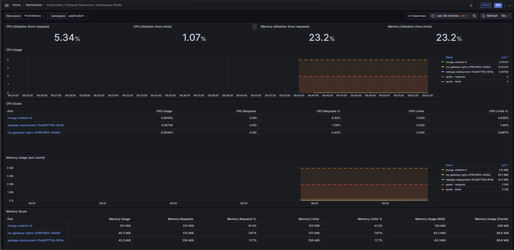
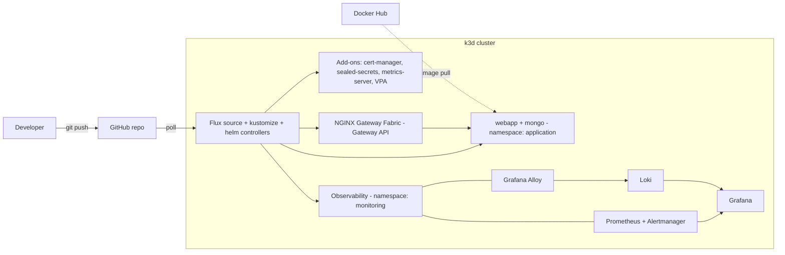

# mywebapp-k8s-helm

A GitOps-managed Kubernetes platform for a Next.js + MongoDB web app, running locally on k3d. Flux reconciles everything from this repo: add-ons, the app's Helm chart, TLS, secrets, autoscaling and observability.



## What this shows

- **GitOps with Flux:** three Kustomizations (`infrastructure`, then `monitoring` and `apps`) with explicit `dependsOn` ordering, so CRDs always exist before anything uses them.
- **Gateway API** ingress with NGINX Gateway Fabric and cert-manager TLS.
- **Sealed Secrets:** encrypted secrets that are safe to commit.
- **Persistent storage:** Mongo runs as a StatefulSet on a PVC, and its data survives pod restarts.
- **Autoscaling:** HPA on CPU (1-3 replicas) and VPA on memory only, so they don't fight.
- **Observability:** Prometheus and Grafana for metrics, Alloy and Loki for logs.

## Architecture



## Repository layout

```
clusters/local-k3d/   Flux entry point
infrastructure/       Sources, CRDs, controllers, namespace config
monitoring/           kube-prometheus-stack, Loki, Grafana Alloy
apps/webapp/          HelmRelease for the app
charts/               mywebapp and infrastructure-namespace Helm charts
scripts/              bootstrap.sh, seal-secrets.sh
docs/                 Design notes and troubleshooting
```

## Getting started

Prerequisites: WSL2, Docker Desktop, `kubectl`, `k3d`, `flux`, `kubeseal`.

```bash
# 1. Create a short-lived fine-grained GitHub token (this repo only,
#    Administration + Contents read/write) and export it
export GITHUB_TOKEN=...

# 2. Create the k3d cluster (ports 80/443, Traefik disabled so NGF owns them)
#    and bootstrap Flux
scripts/bootstrap.sh

# 3. Bootstrap pushes a commit, so pull it, then revoke the token
git pull

# 4. Watch everything come up
flux get kustomizations -A
flux get helmreleases -A --watch
```

Then open the app and Grafana. The routes match the host `webapp.local`, so add it to your hosts file first (`127.0.0.1 webapp.local`; on WSL2 that is the Windows hosts file):

```bash
# App: https://webapp.local (self-signed certificate, so accept the browser warning)
# Grafana:
kubectl port-forward -n monitoring svc/monitoring-kube-prometheus-stack-grafana 3000:80   # http://localhost:3000
```

## More detail

- [Design notes](docs/design.md): layout, design decisions, secrets workflow, observability.
- [Troubleshooting notes](docs/troubleshooting.md): problems hit while building this, with causes and fixes.

## Known limitations and next steps

- The cluster is created with k3s's bundled Traefik disabled. Otherwise it holds ports 80/443, the NGF `svclb` pod stays `Pending`, and requests to `webapp.local` get Traefik's 404.
- The app only logs at startup, so its log panel is sparse until it logs requests.
- Planned: request-level metrics, an SLO-based alert and a blackbox probe.

## Related work

- Planned: floci (local AWS emulator) with Terraform for VPC/IAM/S3, probably in a separate repo.
